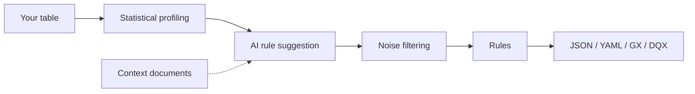

# Welcome to DataBuck SDK

DataBuck SDK profiles your data and **auto-discovers data quality rules** using statistical profiling powered by AI. It runs entirely inside your own environment, such as a Databricks or Microsoft Fabric notebook, and needs very little code.


**Mock content.** These pages are a test of GitBook layout. Package names, method names and parameters are placeholders.


## Watch the introduction


Introduction to DataBuck by FirstEigen


## Start here

<table data-view="cards">
  <thead>
    <tr>
      <th width="48"></th>
      <th></th>
      <th></th>
      <th data-hidden data-card-target data-type="content-ref"></th>
    </tr>
  </thead>
  <tbody>
    <tr>
      <td><i class="fa-download"></i></td>
      <td><strong>Installation</strong></td>
      <td>Install the SDK with pip, in Databricks or in Fabric.</td>
      <td><a href="getting-started/installation.md">installation</a></td>
    </tr>
    <tr>
      <td><i class="fa-bolt"></i></td>
      <td><strong>Quickstart</strong></td>
      <td>Discover your first rules in under five minutes.</td>
      <td><a href="getting-started/quickstart.md">quickstart</a></td>
    </tr>
    <tr>
      <td><i class="fa-robot"></i></td>
      <td><strong>Configuring AI</strong></td>
      <td>Bring your own model and add context documents.</td>
      <td><a href="guides/configuring-ai.md">configuring-ai</a></td>
    </tr>
    <tr>
      <td><i class="fa-file-export"></i></td>
      <td><strong>Exporting rules</strong></td>
      <td>Export to JSON, YAML, Great Expectations or DQX.</td>
      <td><a href="guides/exporting-rules.md">exporting-rules</a></td>
    </tr>
    <tr>
      <td><i class="fa-chart-column"></i></td>
      <td><strong>Benchmark</strong></td>
      <td>How DataBuck compares with PyDeequ and DQX.</td>
      <td><a href="reference/benchmark.md">benchmark</a></td>
    </tr>
    <tr>
      <td><i class="fa-layer-group"></i></td>
      <td><strong>Editions</strong></td>
      <td>Developer SDK vs Enterprise SDK.</td>
      <td><a href="reference/editions.md">editions</a></td>
    </tr>
  </tbody>
</table>

## How it works

## Links

<a href="https://firsteigen.com/databuck/" class="button primary" data-icon="globe">DataBuck website</a> <a href="https://github.com/FirstEigen-Labs/databuck_sdk" class="button secondary" data-icon="github">SDK on GitHub</a>
