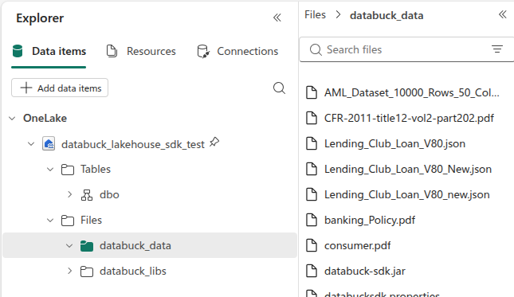
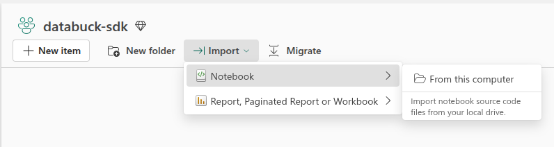
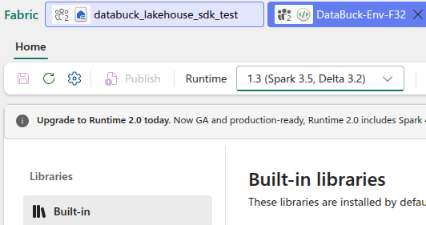
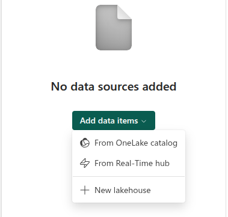
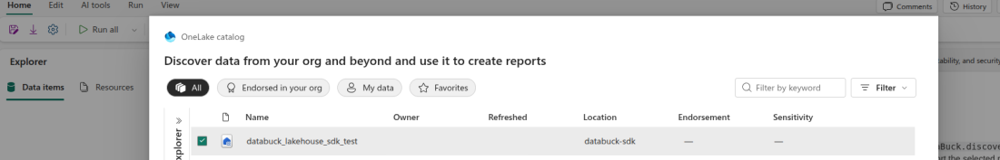
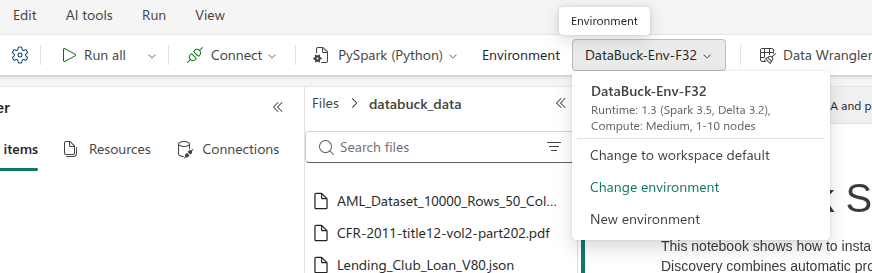

# Microsoft Fabric

Run the DataBuck SDK in a Microsoft Fabric notebook: set up access, a Lakehouse and an Environment, install the SDK, load its Spark JAR, and generate data quality rules. This guide uses Fabric Runtime 1.3 (Apache Spark 3.5, Delta 3.2).

## Prerequisites

* Fabric capacity assigned to the workspace (F64 recommended, F32 minimum)
* Workspace Admin rights, to create a Lakehouse, Environment and Notebook and assign workspace roles
* Microsoft Entra ID rights to create a security group, or an admin who can
* These files on your machine:
  * your signed `databucksdk.properties` license file
  * policy documents (PDF or DOCX), for AI-generated rules
  * source data as a CSV, or a Delta table already in the Lakehouse
* Optional: the [DataBuck Fabric notebook](https://tmplog1-pub.s3.us-east-1.amazonaws.com/DataBuck_SDK_Fabric_Notebook.ipynb), to import in step 3
* Optional: a Gemini API key stored in Azure Key Vault, for AI-generated rules

## 1. Create a user group

This step needs Entra ID admin or Group Administrator rights.

1. Open the **Microsoft Entra admin center** > **Groups** > **New group**.
2. Set **Group type** to **Security**, name it `databuck_sdk_grp`, then select **Create**.
3. Open the group > **Members** > **Add members**, and add each user who will run DataBuck.
4. In Fabric, open the workspace > **Manage access** > **Add people or groups**, and add `databuck_sdk_grp` with the **Contributor** role (or **Member**, per your governance model).

Fabric controls access through workspace roles, so the group's role sets what its members can do.

## 2. Create a Lakehouse and upload files

The Lakehouse stores the license, JAR, policy documents, source data and output rules.

1. In the workspace, select **+ New item**, search for **Lakehouse**, and select it.
2. Name it, for example `databuck_lakehouse`, then select **Create**.
3. When it opens, select **Files** > **+ New subfolder**, and name it `databuck_data`.
4. Open `databuck_data` > **Upload** > **Upload files**, and upload:
   * `databucksdk.properties`
   * your policy PDFs or DOCX files
   * your source CSV (skip if you use a Delta table)

<figure><figcaption><p>Uploaded files in the databuck_data folder</p></figcaption></figure>

The files are then available in notebooks at these paths:

```
/lakehouse/default/Files/databuck_data/databucksdk.properties
/lakehouse/default/Files/databuck_data/<policy>.pdf
/lakehouse/default/Files/databuck_data/<source>.csv
```

The JAR is not uploaded here. The SDK downloads it to `databuck_data` in step 10.


Keep the folder name `databuck_data` consistent. The code in this guide uses it.


## 3. Create a notebook

To start from the DataBuck notebook, [download it](https://tmplog1-pub.s3.us-east-1.amazonaws.com/DataBuck_SDK_Fabric_Notebook.ipynb), then select **Import** > **Notebook** > **From this computer**, and choose the downloaded file.

<figure><figcaption><p>Importing a notebook</p></figcaption></figure>

Do not run any cells yet. They fail until the Lakehouse and Environment are attached.

## 4. Create and publish an Environment

The Environment sets the runtime that every notebook session uses.

1. In the workspace, select **+ New item**, search for **Environment**, and select it.
2. Name it, for example `DataBuck SDK Env`, then select **Create**.
3. In the Environment editor, open the **Runtime** tab and select **1.3 (Spark 3.5, Delta 3.2)**.
4. Select **Save**, then **Publish** in the ribbon, and confirm.
5. Wait until the status shows **Published**.

<figure><figcaption><p>Runtime 1.3 selected in the Environment</p></figcaption></figure>

## 5. Attach the Lakehouse to the notebook

1. Open the notebook from step 3.
2. In the **Explorer** pane, select **Add data items** > **From OneLake catalog**.

   <figure><figcaption></figcaption></figure>

3. Select `databuck_lakehouse` in the catalog, then confirm.

   <figure><figcaption></figcaption></figure>

4. Expand the Lakehouse > **Files**, and confirm `databuck_data` and your files are visible.


Without an attached Lakehouse, paths under `/lakehouse/default/Files/` fail with "path not found".


## 6. Attach the Environment to the notebook

1. In the notebook ribbon, open the **Environment** dropdown > **Change environment**, and select `DataBuck SDK Env`.
2. Confirm the dropdown shows your Environment with **Runtime: 1.3**.

<figure><figcaption><p>The Environment attached to the notebook</p></figcaption></figure>
3. Start a session by running a simple cell, such as `print(spark.version)`.

## 7. Install the SDK

Pin a version so results are reproducible:

```python
%pip install --upgrade --no-cache-dir databuck-sdk==0.5.56
```

## 8. Restart Python

```python
import notebookutils
notebookutils.session.restartPython()
```

Restarting clears all variables, so run the next steps after it.

## 9. Set the license and JAR paths

Set both paths **before** importing `databuck`:

```python
import os

os.environ["DATABUCK_SDK_CONFIG_FILE"] = (
    "/lakehouse/default/Files/databuck_data/databucksdk.properties"
)
os.environ["DATABUCK_SDK_JAR"] = (
    "/lakehouse/default/Files/databuck_data/databuck-sdk.jar"
)
```

Use the full file name ending in `.jar`, not just the folder.

## 10. Import DataBuck and download the JAR

```python
from importlib.metadata import version
from databuck import DataBuck

print(version("databuck-sdk"))
print(DataBuck.jar_path())
```

The import validates the license and downloads the JAR to the path from step 9. Later imports reuse it. Refresh **Files** > `databuck_data` to see `databuck-sdk.jar`.

## 11. Load the JAR into Spark

Downloading the JAR does not add it to Spark. Load it with a `%%configure` cell, using the JAR's ABFS path (in the Lakehouse, right-click `databuck-sdk.jar` > **Copy ABFS path**):

```json
%%configure -f
{
    "conf": {
        "spark.jars": "abfss://<workspace>@onelake.dfs.fabric.microsoft.com/databuck_lakehouse.Lakehouse/Files/databuck_data/databuck-sdk.jar"
    }
}
```


`%%configure -f` restarts the session and clears Python state. After it runs, repeat steps 7 to 10, then continue to discovery.


Repeat steps 7 to 10 whenever the session restarts for any other reason, such as an Environment publish or capacity recycling.

## 12. Load your data (optional)

To pass a DataFrame instead of a Delta table, load your CSV using its ABFS path (right-click the file > **Copy ABFS path**):

```python
csv_path = "abfss://<workspace>@onelake.dfs.fabric.microsoft.com/databuck_lakehouse.Lakehouse/Files/databuck_data/<source>.csv"

df = (
    spark.read
    .option("header", True)
    .option("inferSchema", True)
    .csv(csv_path)
)
```

## 13. Generate rules

Pass a DataFrame or a Lakehouse Delta table name (`<lakehouse>.<schema>.<table>`), plus an output path:

```python
import notebookutils

gemini_api_key = notebookutils.credentials.getSecret(
    "https://<key-vault-name>.vault.azure.net/", "<secret-name>"
)

output_path = DataBuck.discover(
    df,  # or "databuck_lakehouse.dbo.<table>"
    "/lakehouse/default/Files/databuck_data/rules.json",
    context={
        "gemini_api_key": gemini_api_key,
        "domain_name": "banking",
        "pdf_paths": [
            "/lakehouse/default/Files/databuck_data/<policy-1>.pdf",
            "/lakehouse/default/Files/databuck_data/<policy-2>.pdf",
        ],
    },
)
print(f"Expectations saved to: {output_path}")
```


Never hardcode the API key. Read it from Azure Key Vault as shown.


| `context` key | Effect |
| --- | --- |
| `gemini_api_key` | Key for the LLM calls |
| `domain_name` | Business domain; output keeps only HIGH and MEDIUM priority rules |
| `pdf_paths` | PDF or DOCX policy documents that ground the rules |

Omit `context` to export only automatic profiling rules, all in the `warn` group.

The output extension sets the format: `.json`, `.yaml` or `.gx.json`. For `.gx.json`, install `great-expectations>=1.0,<2`, restart Python, and repeat steps 9 and 10 first. See [Exporting rules](../guides/exporting-rules.md).

## 14. Check the output

1. In the Lakehouse, refresh **Files** > `databuck_data`, and confirm the rules file is there.
2. Review the generated rules against your business policy before using them in production.
