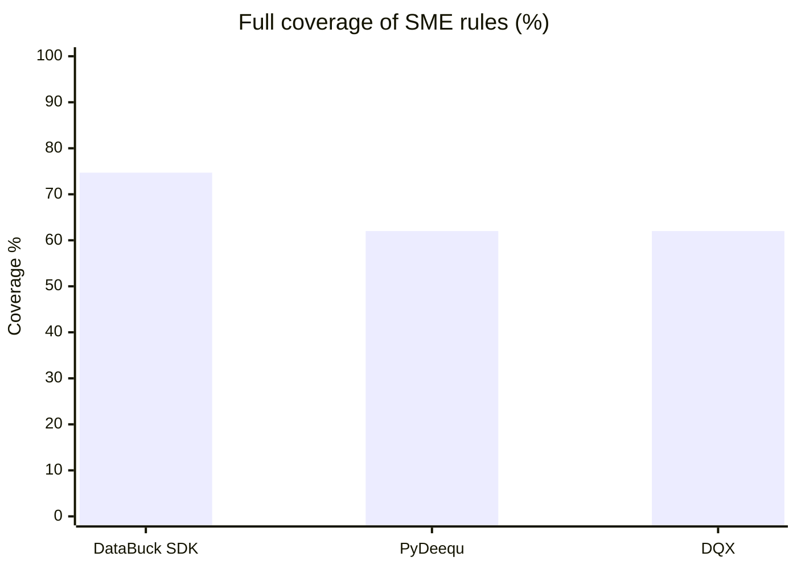

# Benchmark

We compared auto-discovered rules from DataBuck SDK, PyDeequ and Databricks DQX against **79 SME-curated rules** on a LendingClub loan extract with 111 columns.

## Results

| Metric | DataBuck SDK | PyDeequ | DQX |
| --- | --- | --- | --- |
| Coverage (full) | **74.7%** | 62.0% | 62.0% |
| Coverage (incl. partial) | **86.1%** | 67.1% | 62.0% |
| Critical rules covered | **87%** | 61% | 63% |
| Cross-column rules (of 22) | **9 full + 5 partial** | 0 | 0 |
| SME rules missed | **11** | 26 | 30 |
| Rules generated | 137 | 141 | 159 |
| Rules with no SME match | **65** | 87 | 109 |


13 SME rules were caught by DataBuck SDK alone. All three tools combined cover 82%.


## Coverage at a glance

## About the other tools



### PyDeequ



[PyDeequ on GitHub](https://github.com/awslabs/python-deequ)



### Databricks DQX



[DQX on GitHub](https://github.com/databrickslabs/dqx)


